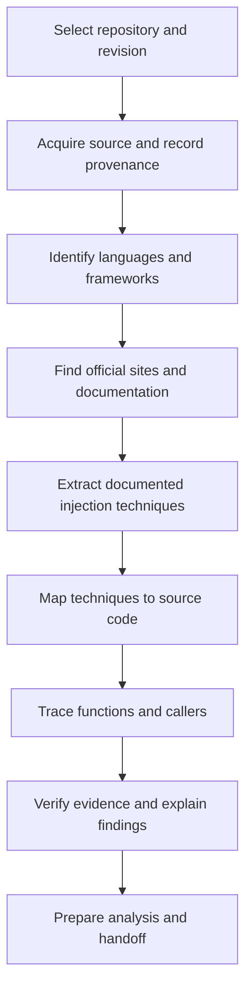

This directory defines the high-level concepts, business logic, and architecture of this project using markdown. It is managed by [lat.md](https://www.npmjs.com/package/lat.md) — a tool that anchors source code to these definitions. Install the `lat` command with `npm i -g lat.md` and run `lat --help`.

# Repository injection analysis workflow

Reusable workflow for tracing documented code-injection techniques into a repository's source and call paths.

**Language / Dil:** [EN](repo-analysis-en.md) | [TR](repo-analysis-tr.md)

Use one language page at a time. Fill its step sections with evidence; distinguish documented behavior, source observations, and analysis. A framework match alone does not establish that a technique is present.

- [[repo-analysis-en]] — English step-by-step template
- [[repo-analysis-tr]] — Türkçe adım adım şablon
